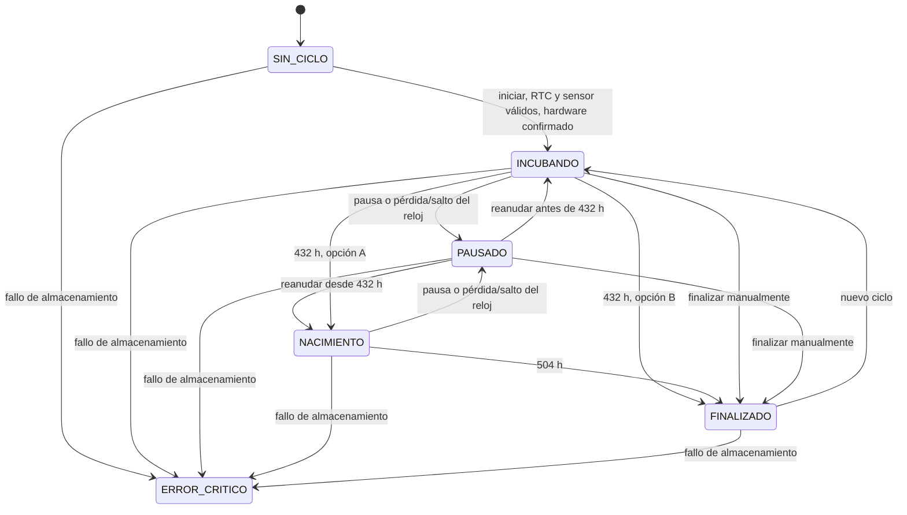

# Arquitectura y reglas de operación

## Componentes

```text
Teléfono ── WiFi AP / HTTP ── WebServer (loop Arduino)
                               │ mutex: copiar estado / aplicar comandos
                               ▼
                        App: máquina de estados
                               ▲
Tarea control 10 ms ────────────┤
    ├─ DHT22: cada 2,5 s        ├─ NVS: cambios relevantes
    ├─ DS3231: cada 1 s         ├─ historial circular: 48 eventos RAM
    ├─ control ambiental       └─ LCD: cada 500 ms, solo líneas diferentes
    └─ motor: temporizador esp_timer independiente + validación de etapa
```

`config.h` contiene estructuras, validación y funciones de lógica puras. `app.cpp` reúne ciclo, arbitraje ambiental y programación del motor: mantener sus transiciones en una sola unidad evita decisiones contradictorias. `relays`, `sensors`, `rtc_manager`, `storage`, `lcd_manager` y `web_server` separan los periféricos. La exportación Arduino genera un `.ino` con las mismas fuentes, sin mantener una segunda implementación.

El servidor nunca mantiene el mutex durante una transmisión HTTP. El control funciona sin navegador o clientes WiFi. Un temporizador de una sola ejecución corta el GPIO del motor aunque el servidor esté ocupado. El watchdog supervisa la tarea de control con plazo de 8 segundos; la tarea cede CPU cada 10 ms. La protección física sigue siendo necesaria para fallos del MCU o contactos pegados.

No hay `delay()` en la lógica del proyecto. Las bibliotecas DHT e I2C realizan operaciones síncronas breves; el DHT22 ocupa unos milisegundos por lectura y el LCD tiene retardos de inicialización internos. I2C tiene timeout de 30 ms por transacción. No se pretende tiempo real duro ni inmunidad a fallos eléctricos.

## Estados



Un inicio retrospectivo desde 432 h puede entrar directamente en NACIMIENTO. El reloj debe indicar 2025–2099. La fecha inicial puede ser actual o pasada dentro de la duración; no se permite inicio futuro. Todos los cambios exigen confirmación y autenticación. Un ciclo existente debe finalizarse antes de crear otro o modificar los parámetros.

Tiempo lógico = segundos acumulados al pausar + (RTC actual − RTC al reanudar). Durante pausa no avanza el ciclo; motor apagado y regulación ambiental activa con los parámetros de la etapa congelada. Se conserva el total conocido de segundos de pausa. El apagón con RTC válido cuenta como tiempo de incubación; un apagón durante una pausa no cuenta. La hora se trata como **hora local del equipo**, sin ajustes automáticos de zona o verano.

Día visible = piso(horas/24)+1, limitado a 21. El nacimiento comienza al **completar** 18 días (432 h), que corresponde al inicio del día ordinal 19; se evita confundir «inicia día 18» con «18 días cumplidos». La barra y simulación utilizan segundos exactos.

## Motor y reinicios

1. Registrar en NVS `motorPending=true`, instante del intento y siguiente ranura **antes** de energizar.
2. Encender solo en INCUBANDO, antes de 432 h, con RTC y DHT confiables, hardware confirmado y temperatura por debajo de emergencia.
3. Temporizar con `esp_timer`, duración configurada ≤ límite configurado ≤ 120 s absolutos.
4. Al vencer, cortar GPIO, registrar confirmación y retirar marca pendiente. El usuario no puede alargar un movimiento en curso.
5. Una pausa, cambio de etapa, falla de sensor/reloj o sobretemperatura corta el motor. Un movimiento interrumpido se consume.
6. Al reiniciar: todas las salidas apagadas; cualquier intento pendiente se considera incierto, se registra y **no se repite**. Las ranuras hasta la hora de arranque se omiten, incluso la que coincide exactamente con el arranque. Nunca se recuperan movimientos acumulados.
7. Un movimiento manual consume su intento y reprograma el siguiente para un intervalo completo después. No es un bypass de etapa, sensor, temperatura o reloj.
8. Una ranura retrasada más de 5 segundos se omite. La programación es relativa al tiempo lógico: las pausas desplazan los futuros movimientos.

No hay realimentación mecánica: «completado» confirma únicamente la terminación del pulso eléctrico; no demuestra que el motor giró. Instalar finales de carrera, limitación mecánica o monitor de corriente si el mecanismo los requiere.

## Seguridad ambiental

| Condición | Calefacción | Humidificador | Ventilador | Motor |
|---|---|---|---|---|
| Instalación no confirmada / NVS inválida | OFF | OFF | OFF | OFF |
| Sensor inválido/obsoleto | OFF | OFF | Según política emergencia | OFF |
| Sobretemperatura válida | OFF inmediato | OFF inmediato | ON | OFF |
| RTC inválido | Regula con sensor válido | Regula con sensor válido | Regula | OFF; ciclo pausado |
| Pausa | Regula | Regula | Regula | OFF |
| Nacimiento | Parámetros nacimiento | Parámetros nacimiento | Parámetros nacimiento | OFF |
| Sin ciclo / finalizado | OFF o regulación elegida | Igual | Igual, salvo emergencia | OFF |

Un fallo de sensor bloquea con la primera lectura inválida; no espera agotar 7 s. La antigüedad de la última lectura válida se muestra para diagnóstico. Las alarmas de rango ambiental son distintas de ERROR SENSOR. El ventilador térmico tiene prioridad sobre la calefacción; nunca se permiten ambos por una decisión del control. Los encendidos esperan 5 s desde el último cambio, los apagados de seguridad no esperan.

Sin ciclo, la regulación opcional utiliza incubación si el tiempo lógico es menor a 432 h y nacimiento si ya alcanzó 432 h. Tras finalizar manualmente, conserva la etapa alcanzada. Esta política se muestra en ajustes y se devuelve en `/api/status`. Por defecto todo apagado. La sobretemperatura activa ventilación incluso fuera de ciclo, cuando el hardware está confirmado; la política de fallo de sensor también se aplica fuera de ciclo.

## Pérdida de referencia temporal

Un RTC ausente, bandera de batería perdida, retroceso, reloj detenido por más de 5 s o discrepancia de más de 5 s respecto del tiempo monotónico bloquea el motor. Durante operación, se congela el último tiempo lógico conocido y se pasa a PAUSADO. Para ajustar hora hay que pausar; después se reanuda explícitamente.

Si el reloj es inválido al arrancar, solo puede recuperarse el tiempo lógico del último punto persistido (inicio/pausa/reanudación); no se inventa la duración del apagón. El operador debe revisar la duración. Si no coincide con la realidad, finalizar y crear un ciclo con una fecha inicial reconstruida. No se escriben checkpoints cada segundo. Pequeños ajustes externos del RTC de hasta 5 s pueden no detectarse: el módulo no debe ajustarse con otro dispositivo mientras opere.

## Persistencia y acceso

NVS guarda dos registros completos (`Config`, `Cycle`) con versión y checksum FNV-1a. Cada registro se escribe con una operación `putBytes`; una configuración incompleta o inválida bloquea las salidas. Los cambios entre registros no constituyen una transacción conjunta: si se interrumpe el primer provisionamiento, puede requerirse mantenimiento local. Un error de escritura bloquea control; no se sigue operando con estado incierto.

No se escriben lecturas ni cambios ambientales a flash. Se persisten inicio, pausa, reanudación, fin, etapa, intentos y finalización del motor, ranuras omitidas y parámetros. Los 48 eventos son circulares en RAM y se pierden en el reinicio; el arranque registra recuperación y el estado incierto del último motor desde NVS. La causa `esp_reset_reason` es diagnóstica: POWERON no permite distinguir con certeza un apagón de otro encendido.

Por solicitud del propietario, AP y administración usan inicialmente `CAMBIA_ESTA_CLAVE`. Una migración NVS aplica esta clave una sola vez, incluso con configuración existente; las modificaciones posteriores desde el panel se conservan. Ambas claves admiten 8–63 caracteres. HTTP Basic local, credencial solo en memoria del navegador, sin CDN ni servicios remotos. Las mutaciones requieren JSON, cabecera propia, Host IP esperado y confirmación; no se habilita CORS. Diez fallos de autenticación bloquean intentos por minuto. HTTP no cifra extremo a extremo: usar una red privada y proteger físicamente USB, donde se pueden recuperar claves. NVS no está cifrada; no está diseñado para una red hostil ni exposición a Internet.
